# 24种运镜 GIF 学习手册

本手册用统一的Blender场景演示24段方向细分运镜，每段GIF为5秒。配套的中英文提示词是可复用的运镜模块，描述相机路径、方向、速度、取景和画面效果。将运镜模块追加到你自己的主体、动作与场景提示词后即可使用；方括号中的景别、取景对象、高度和角度按需要填写。GIF展示具体教学示例，通用模板用于自由搭配创作内容。

## 阅读规则

- **左右**：摇镜头、平移和甩镜的左右，按摄影机初始朝向判断。摄影机转向左侧时，静止背景通常向画面右侧滑动。
- **顺逆时针**：从场景正上方俯视判断。两个环绕沿同一条110度圆弧反向运动，并非完整360度环绕。
- **前后与侧面跟拍**：前后指相机在人物的前方或后方；左右侧指人物自身左右。相机与人物同步运动，才能维持相对距离。
- **人物动作**：第09至12段和第23至24段人物行走，其余示例站立。第09段与第24段采用相同的平稳后方路线，用来对照第23段手持效果。
- **循环与清晰度**：GIF到终点后会直接回到起点，重复观看不代表相机反向运动。普通段落以12fps采样；甩镜保留24fps采样。GIF为256色教学预览，原始工程为24fps。

GIF 与本文件同目录下的 GIF 文件夹对应。浏览器打开运镜学习手册.html，可播放动画、筛选类别并复制提示词。

## 易混淆的区别

| 比较 | 识别方式 | 对照段落 |
|---|---|---|
| 推镜头 ↔ 变焦推近 | 推镜头改变相机位置；变焦改变焦距。二者都能放大主体，但只有实际位移会改变拍摄视点。 | 01 ↔ 17 |
| 摇镜头 ↔ 平移镜头 | 摇是在同一位置转向；平移是将整个相机移到另一个位置。平移更明显地改变前后景视差。 | 03/04 ↔ 07/08 |
| 上摇 ↔ 上升 | 上摇只改变朝向；上升改变相机高度。本例上升还配合俯转以继续看人物。 | 05 ↔ 13 |
| 环绕 ↔ 原地转动 | 环绕改变相机围绕主体的位置，并持续瞄向主体；原地转动则是摇镜头。 | 15/16 ↔ 03/04 |
| 普通推拉 ↔ 希区柯克变焦 | 普通推拉通常让人物大小变化；希区柯克变焦通过反向改变焦距，使人物大小近似稳定而背景关系改变。 | 01/02 ↔ 19/20 |
| 路径 ↔ 稳定方式 | 跟拍描述相机如何跟随主体；手持或稳定拍摄描述运动是否带晃动。两者可以组合。 | 09 ↔ 23/24 |

## 运镜与景别

景别回答“画面里看见多少主体与环境”；运镜回答“摄影机怎样运动”。两者可以自由组合，例如“中景，缓慢左摇”或“从远景推进到中近景”。希区柯克变焦可以让主体景别基本不变，同时改变背景关系。各教材对景别边界和英文译名的划分可能不同，提示词最好直接写“全身”“腰部以上”等可见范围。Wide shot描述取景范围，wide-angle lens描述广角镜头，两者不是同一个参数。

| 景别 | 画面内容 | 常见关注点 |
|---|---|---|
| 大远景 | 环境占绝大部分，人物像小点。 | 交代地点、气势或人和环境的尺度差。 |
| 全远景 | 较完整地展示大范围场地，人物很小但形态可辨。 | 先看场地布局，再用推近或下降引入人物。 |
| 远景或宽景 | 人物及较多周围环境可见。 | 展示人物与地点关系，适合平移、跟拍或环境揭示。 |
| 中远景 | 常见取景为膝部以上或人物占比较大的全身环境景。 | 兼顾人物动作和周围环境。 |
| 中景 | 常见取景为腰部以上。 | 看动作、对话和人物之间的关系。 |
| 中近景 | 常见取景为胸部以上。 | 加强表情，同时保留部分动作。 |
| 特写 | 脸部或一个主要对象占据画面。 | 强调表情、线索或物件。 |
| 大特写 | 脸部占比更大，可能裁掉头顶或下巴。 | 强调强烈情绪、局部细节。 |
| 极特写 | 眼睛、手指或极小细节充满画面。 | 让一个细节成为关注中心。 |

## 01 推镜头 Dolly In

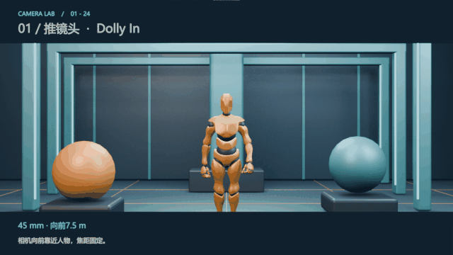

Blender第1至120帧，每段5秒。参数：45 mm · 向前7.5 m。

**特点**：相机沿纵深靠近主体，焦距保持不变。人物逐渐变大，同时前景与远景之间的遮挡和相对比例发生变化。

**用途**：强调关键人物、靠近表情或物件、让观众逐渐进入一个发现过程。缓慢推进常用于积累注意力；推进速度也能改变节奏。

**观察**：看人物变大时，两侧球体和后方立柱如何相对人物移动；空间变化来自机位前进。

**景别搭配**：可从远景或全身景收紧到中景、近景；起终景别要同时写明。

**提示词要点**：只写“放大人物”容易得到变焦。需要写明相机真实前进、焦距固定和空间视差。

**中文通用运镜模板**

相机以固定焦距沿纵深缓慢向主体推进，取景由[起始景别]逐渐收紧到[结束景别]。主体在画面中逐渐变大，前后景产生自然的相对视差。运动平稳连续，始终保持主体清晰可见。

**English camera-motion template**

The camera physically dollies slowly forward toward the subject at a fixed focal length, tightening the framing from [starting shot size] to [ending shot size]. The subject gradually grows in the frame as foreground and background exhibit natural relative parallax. Maintain smooth, continuous motion and keep the subject clearly visible.

关键词：dolly in / push in / fixed focal length / parallax

## 02 拉镜头 Dolly Out

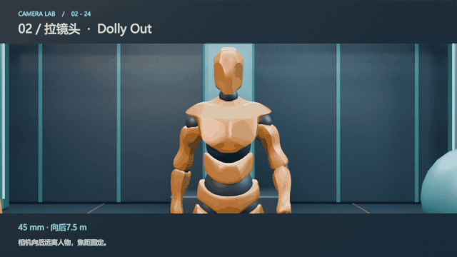

Blender第121至240帧，每段5秒。参数：45 mm · 向后7.5 m。

**特点**：相机沿纵深离开主体，焦距保持不变。人物逐渐变小，周围场地进入画面，空间关系随机位后退改变。

**用途**：揭示人物所处的环境、展示孤独或规模感、为一个段落留出结束的空间。

**观察**：人物缩小的同时，地面、两侧雕塑与建筑被逐步带入。

**景别搭配**：可从中景或近景拉到全身景、远景；远景更突出人物与环境的比例。

**提示词要点**：拉镜头需要机位后退。人物自己向远处走，以及固定机位的变焦拉远，都是另外的动作。

**中文通用运镜模板**

相机以固定焦距沿纵深缓慢远离主体，取景由[起始景别]逐渐展开到[结束景别]。主体在画面中逐渐变小，周围空间逐步进入画面，前后景的相对关系随实际机位后退而改变。运动平稳连续。

**English camera-motion template**

The camera physically dollies slowly backward away from the subject at a fixed focal length, widening the framing from [starting shot size] to [ending shot size]. The subject gradually becomes smaller as surrounding space is revealed. Foreground and background relationships change with the actual camera retreat. Keep the movement smooth and continuous.

关键词：dolly out / pull back / reveal environment

## 03 左摇镜头 Pan Left

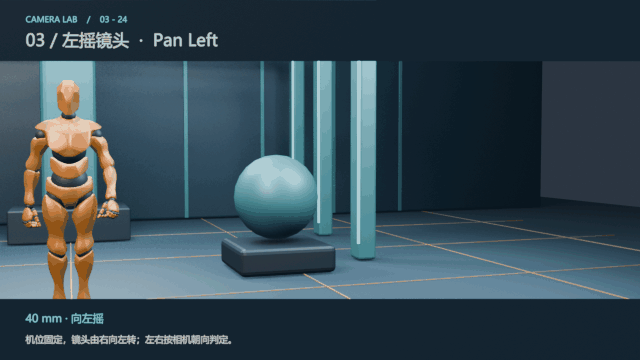

Blender第241至360帧，每段5秒。参数：40 mm · 向左摇。

**特点**：相机中心位置固定，朝向水平转向左侧；镜头像人在原地转头。画面中的静止物体通常向右滑过。

**用途**：从右侧信息扫到左侧信息、跟随向左运动的主体、揭示人物左边的空间。左右只指定信息展开的顺序，并不固定代表某一种情绪。

**观察**：背景整体向画面右边滑动；相机没有横向搬到另一个机位。

**景别搭配**：可用于远景扫描或中景之间的重新构图；不要求景别必然改变。

**提示词要点**：“左摇”指相机转向左侧，不能用背景向左滑动来判断方向。

**中文通用运镜模板**

相机中心位置固定，原地平稳水平向左摇动，视线从右侧的[起始取景对象]转向左侧的[结束取景对象]。相机高度与焦距保持不变，静止场景元素通常向画面右侧滑动，最后平稳停住。

**English camera-motion template**

Keep the camera center fixed and pan smoothly to the camera’s left, shifting the view from [starting visual target] on the right to [ending visual target] on the left. Maintain camera height and focal length. Stationary scene elements generally travel to screen right. Settle smoothly at the end.

关键词：pan left / fixed camera position / horizontal rotation

## 04 右摇镜头 Pan Right

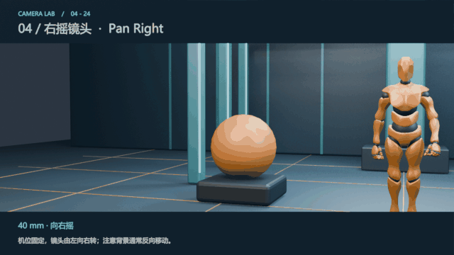

Blender第361至480帧，每段5秒。参数：40 mm · 向右摇。

**特点**：相机中心位置固定，朝向水平转向右侧；静止物体通常向画面左侧滑过。

**用途**：从左侧信息扫到右侧信息、跟随向右运动的主体、交代人物右边的对象或空间。

**观察**：与左摇对照，背景的滑动方向反转，但机位仍固定。

**景别搭配**：远景、中景、近景都可以右摇，取景大小与摇动方向是两个参数。

**提示词要点**：使用“向右移动镜头”容易让模型横向平移；写“原地水平转向右侧”。

**中文通用运镜模板**

相机中心位置固定，原地平稳水平向右摇动，视线从左侧的[起始取景对象]转向右侧的[结束取景对象]。相机高度与焦距保持不变，静止场景元素通常向画面左侧滑动，最后平稳停住。

**English camera-motion template**

Keep the camera center fixed and pan smoothly to the camera’s right, shifting the view from [starting visual target] on the left to [ending visual target] on the right. Maintain camera height and focal length. Stationary scene elements generally travel to screen left. Settle smoothly at the end.

关键词：pan right / fixed pivot / horizontal rotation

## 05 上摇镜头 Tilt Up

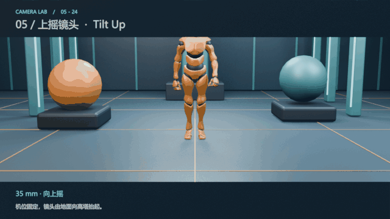

Blender第481至600帧，每段5秒。参数：35 mm · 向上摇。

**特点**：机位和相机高度固定，镜头朝向向上转动。视线从低处移到高处，摄影机自身没有升高。

**用途**：从脚部抬到表情、展示建筑高度、从地面线索揭示上方对象。

**观察**：先看地面与人物，再看上方立柱；变化来自镜头仰起。

**景别搭配**：可跨过不同身体部位或由地面细节到建筑远景；这属于重新取景。

**提示词要点**：“镜头上升”容易变成升机位。应写“机位固定、镜头原地向上仰”。

**中文通用运镜模板**

相机位置和高度固定，镜头原地缓慢向上仰转，视线从低处的[起始取景对象]逐步移向高处的[结束取景对象]。焦距恒定，通过连续的向上摇动展开垂直方向的信息，最后平稳停住。

**English camera-motion template**

Keep camera position and height fixed. Tilt the lens slowly upward from [starting visual target] below to [ending visual target] above. Maintain a constant focal length and reveal vertical information through continuous upward rotation. Settle smoothly at the end.

关键词：tilt up / fixed camera height / rotate upward

## 06 下摇镜头 Tilt Down

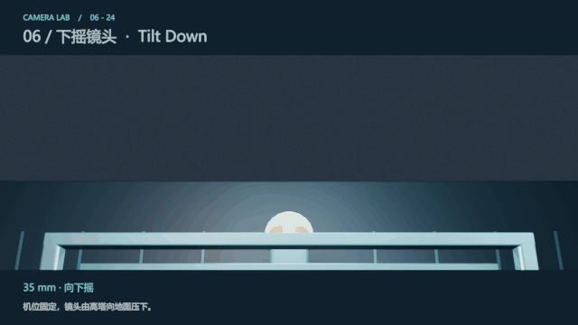

Blender第601至720帧，每段5秒。参数：35 mm · 向下摇。

**特点**：机位和相机高度固定，镜头朝向向下转动。视线从高处移向低处。

**用途**：从建筑落到人物、揭示手中的物件或地面线索、按自上而下的顺序介绍对象。

**观察**：观察上方建筑逐步退出，人物与地面逐步进入。

**景别搭配**：可从建筑远景摇到人物全身景，也可从脸部近景摇到手部。

**提示词要点**：向下摇并不是从高处降下摄影机；拍摄视点的高度应保持固定。

**中文通用运镜模板**

相机位置和高度固定，镜头原地缓慢向下俯转，视线从高处的[起始取景对象]逐步移向低处的[结束取景对象]。焦距恒定，通过连续的向下摇动展开垂直方向的信息，最后平稳停住。

**English camera-motion template**

Keep camera position and height fixed. Tilt the lens slowly downward from [starting visual target] above to [ending visual target] below. Maintain a constant focal length and reveal vertical information through continuous downward rotation. Settle smoothly at the end.

关键词：tilt down / fixed camera position / rotate downward

## 07 左移镜头 Truck Left

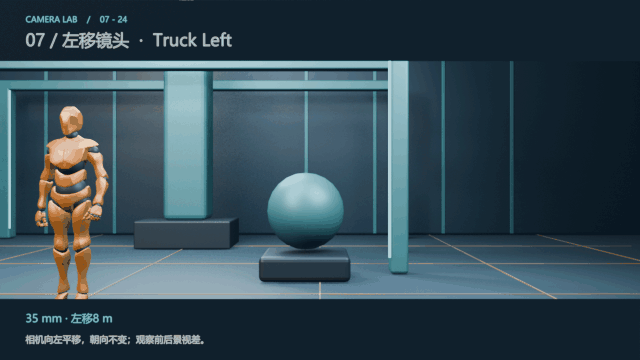

Blender第721至840帧，每段5秒。参数：35 mm · 左移8 m。

**特点**：摄影机整体向左平移，本例保持初始朝向和焦距。前景与远景滑动速度不同，带来明显横向视差。

**用途**：穿过遮挡揭示人物、沿商品或建筑侧向展示、建立环境中物体的位置关系。

**观察**：看近处雕塑与远处立柱的相对滑动；这比背景整体同速移动更能识别平移。

**景别搭配**：可保持远景或中景，主体可能在画面内横向移动；本例不锁定人物居中。

**提示词要点**：平移若同时持续转向人物，会成为带摇动的侧移或弧线效果；本例朝向固定。

**中文通用运镜模板**

相机整体沿直线向自身左侧平稳横移，保持原有朝向、拍摄高度和焦距，以[景别]取景。近处元素与远处元素产生不同幅度的横向滑动，形成清楚的空间视差，主体可在画面内自然横向移动。

**English camera-motion template**

Truck the entire camera smoothly left along a straight line, maintaining its original orientation, height and focal length in a [shot size]. Near and distant elements shift horizontally by different amounts, creating clear spatial parallax. Allow the subject to drift naturally across the frame.

关键词：truck left / lateral translation / constant orientation / parallax

## 08 右移镜头 Truck Right

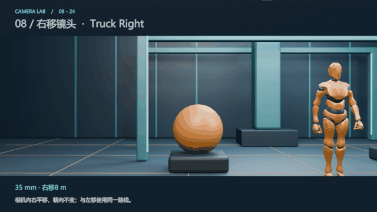

Blender第841至960帧，每段5秒。参数：35 mm · 右移8 m。

**特点**：摄影机整体向右平移，本例朝向与焦距不变，产生与左移相反的横向视差。

**用途**：向右揭示遮挡后的对象、产品侧面展示、沿场地展开空间关系。

**观察**：近处物体比远处物体滑动更快；与右摇相比，实际拍摄位置改变了。

**景别搭配**：远景或中景便于同时看到前后景；并不要求越移越近。

**提示词要点**：写清是摄影机向右平移，而不是人物向右走，也不是摄影机原地右摇。

**中文通用运镜模板**

相机整体沿直线向自身右侧平稳横移，保持原有朝向、拍摄高度和焦距，以[景别]取景。近处元素与远处元素产生不同幅度的横向滑动，形成清楚的空间视差，主体可在画面内自然横向移动。

**English camera-motion template**

Truck the entire camera smoothly right along a straight line, maintaining its original orientation, height and focal length in a [shot size]. Near and distant elements shift horizontally by different amounts, creating clear spatial parallax. Allow the subject to drift naturally across the frame.

关键词：truck right / lateral movement / constant orientation

## 09 后方跟拍 Rear Tracking

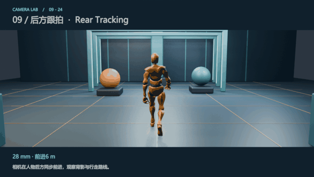

Blender第961至1080帧，每段5秒。参数：28 mm · 前进6 m。

**特点**：相机处在人物后方，沿人物前进方向同步移动。保持距离时，人物大小近似稳定，环境向后流动。

**用途**：带观众进入空间、强调背影与目的地、旅途或探索过程。背影保留了人物的表情信息。

**观察**：人物持续走路且背影大小较稳定，地面和两侧环境不断后退。

**景别搭配**：全身景突出步态和路线；中景突出背部动作与环境入口。

**提示词要点**：人物在走、相机却固定，会得到人物越走越小的固定镜头；跟拍需写同步前进。

**中文通用运镜模板**

相机位于移动主体的正后方，镜头朝向主体，沿主体行进方向等速跟随。保持相同距离、高度和焦距，以[景别]持续取景，使主体在画面中的位置和大小基本稳定，周围环境随行进连续向后流动。

**English camera-motion template**

Track from directly behind the moving subject, aiming at the subject and moving along its route at matching speed. Maintain distance, height and focal length in a [shot size]. Keep the subject’s screen position and size nearly constant while the surroundings flow continuously backward.

关键词：rear tracking / follow from behind / matched speed / constant distance

## 10 前方倒退跟拍 Front Tracking

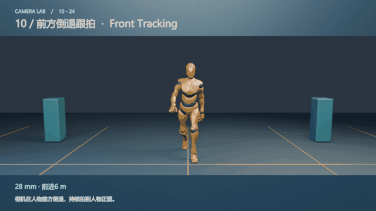

Blender第1081至1200帧，每段5秒。参数：28 mm · 前进6 m。

**特点**：相机位于人物前方，镜头朝向人物正面；人物前进时，相机沿同一行进方向倒退，维持距离。

**用途**：持续看表情、人物对话或边走边讲、展示迎面而来的行动。

**观察**：人物正面可见，距离没有越来越近；环境仍沿路线变化。

**景别搭配**：全身景看步态，中景更便于读表情；选中景时可明确腰部以上。

**提示词要点**：这里“倒退”指摄影师面向人物往后走；世界中的移动方向仍与人物前进方向相同。

**中文通用运镜模板**

相机位于移动主体的正前方，镜头朝向主体，面向主体沿其行进路线同步倒退。保持相同距离、高度和焦距，以[景别]持续拍摄主体正面，使主体位置和大小基本稳定，周围环境连续流动。

**English camera-motion template**

Track from directly ahead of the moving subject while facing it. Retreat along the subject’s route at matching speed, maintaining distance, height and focal length in a [shot size]. Hold a frontal view with nearly constant subject position and size as the surroundings flow continuously.

关键词：front tracking / camera retreats facing subject / matched speed

## 11 左侧平行跟拍 Left Tracking

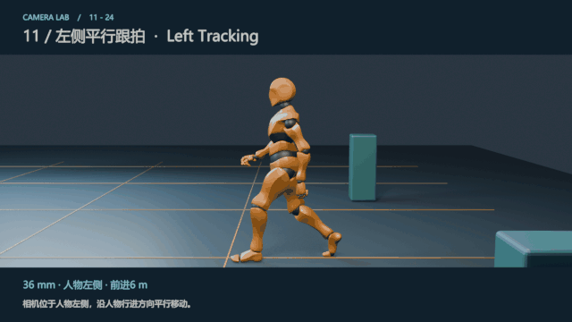

Blender第1201至1320帧，每段5秒。参数：36 mm · 人物左侧 · 前进6 m。

**特点**：相机位于人物自身左侧，沿人物前进方向平行移动，镜头朝向人物侧面。左右以人物行进方向为参照。

**用途**：展示步态、服装轮廓、运动姿势，以及人物经过环境的过程。

**观察**：看人物左侧轮廓与脚步，背景横向滑过；相机不是绕人物转。

**景别搭配**：全身景或中远景便于看完整步态；中景适合侧面动作。

**提示词要点**：“左侧跟拍”指定机位在人物左边，并不意味着相机向画面左边移动。

**中文通用运镜模板**

以主体的行进方向为参照，相机位于主体左侧，镜头朝向其左侧面，沿行进路线等速平行移动。保持侧向距离、高度和焦距，以[景别]取景，使主体大小基本稳定，背景连续横向滑过。

**English camera-motion template**

Relative to the subject’s direction of travel, position the camera on its left side and aim at the left profile. Track parallel to the route at matching speed, maintaining lateral distance, height and focal length in a [shot size]. Keep subject size nearly constant while the background slides continuously across the frame.

关键词：left-side tracking / subject’s left side / parallel movement

## 12 右侧平行跟拍 Right Tracking

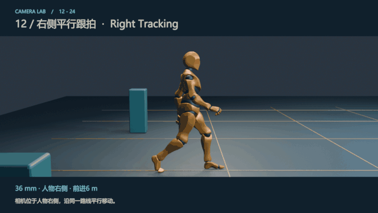

Blender第1321至1440帧，每段5秒。参数：36 mm · 人物右侧 · 前进6 m。

**特点**：相机位于人物自身右侧，沿同一行进方向平行移动。主体与相机相对位置保持稳定。

**用途**：与左侧跟拍构成另一面观察，展示右侧动作、衣服细节或路线旁的背景。

**观察**：人物右侧轮廓可见，背景滑动，人物尺寸近似恒定。

**景别搭配**：全身侧面景看动作；中景侧面景看手势或谈话。

**提示词要点**：左右侧机位不要只写“从左往右拍”，应明确人物自身的哪一侧。

**中文通用运镜模板**

以主体的行进方向为参照，相机位于主体右侧，镜头朝向其右侧面，沿行进路线等速平行移动。保持侧向距离、高度和焦距，以[景别]取景，使主体大小基本稳定，背景连续横向滑过。

**English camera-motion template**

Relative to the subject’s direction of travel, position the camera on its right side and aim at the right profile. Track parallel to the route at matching speed, maintaining lateral distance, height and focal length in a [shot size]. Keep subject size nearly constant while the background slides continuously across the frame.

关键词：right-side tracking / subject’s right side / matching speed

## 13 上升镜头 Crane Up

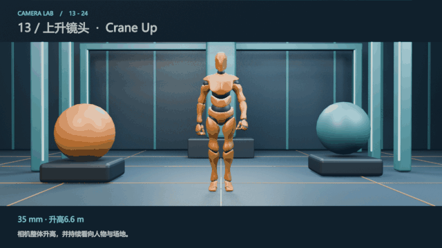

Blender第1441至1560帧，每段5秒。参数：35 mm · 升高6.6 m。

**特点**：摄影机整体升高，俯仰随之调整以继续看向人物。拍摄视点从较低位置变成高处俯拍。本例采用垂直升机位轨迹。

**用途**：展示场地布局、扩大空间规模、从人物过渡到环境关系、为结束段落提供全貌。

**观察**：不仅视线向上或向下转，地面能见度、遮挡和俯视角度都改变了。

**景别搭配**：可从中景或全身景转到高角度远景；机位高度与景别可以分别设置。

**提示词要点**：实际摇臂常沿弧线运动；本例是垂直升降的概念示例，镜头持续瞄向人物。

**中文通用运镜模板**

相机整体从[起始高度]平稳垂直升至[结束高度]，镜头随之调整俯仰，持续朝向主体，焦距固定。画面逐步转为更高角度的观察，展现更多周围空间和布局，最后平稳停住。

**English camera-motion template**

Raise the entire camera smoothly and vertically from [starting height] to [ending height]. Adjust the tilt continuously to keep aiming at the subject while maintaining a fixed focal length. Develop a higher-angle view revealing more surrounding space and layout, then settle smoothly.

关键词：crane up / boom up / vertical rise / tilt to maintain framing

## 14 下降镜头 Crane Down

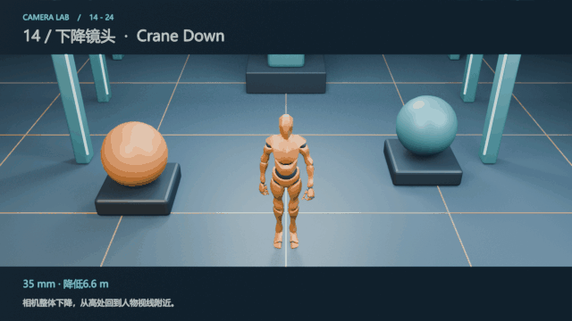

Blender第1561至1680帧，每段5秒。参数：35 mm · 降低6.6 m。

**特点**：摄影机整体降低，同时调整朝向以继续看向人物；高处俯拍逐渐回到接近人物的观察高度。

**用途**：从场地全貌进入人物、建立故事入口、把观众注意力从环境落到主体。

**观察**：地面俯视逐渐减少，人物体积和可见遮挡随视点变化。

**景别搭配**：可由高角度远景到全身景或中景；下降过程中不必改变焦距。

**提示词要点**：下摇只改变朝向；下降同时改变相机中心的高度。

**中文通用运镜模板**

相机整体从[起始高度]平稳垂直降至[结束高度]，镜头随之调整俯仰，持续朝向主体，焦距固定。画面由高处观察逐步回到较低视点，将注意力逐渐集中到主体，最后平稳停住。

**English camera-motion template**

Lower the entire camera smoothly and vertically from [starting height] to [ending height]. Adjust the tilt continuously to keep aiming at the subject while maintaining a fixed focal length. Move from a high-angle observation to a lower viewpoint, gradually concentrating attention on the subject, then settle smoothly.

关键词：crane down / boom down / vertical descent

## 15 顺时针环绕 Orbit CW

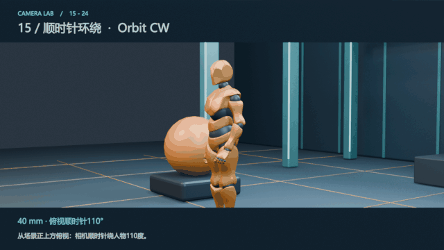

Blender第1681至1800帧，每段5秒。参数：40 mm · 俯视顺时针110°。

**特点**：相机围绕主体沿圆弧移动，持续朝向主体，半径和焦距固定。这里顺时针以场景正上方俯视为准，圆弧为110度。

**用途**：展示立体造型、改变人物与背景的关系、为英雄人物或关键物件增加展示感。速度、景别和表演共同决定情绪。

**观察**：人物近似居中，背景连续横向变化，人物可见侧面随拍摄位置改变。

**景别搭配**：全身景适合展示身形；中景或近景可强化表情和背景流动。

**提示词要点**：本例不是360度绕一整圈，也不是人物自己转身；运动的是摄影机。

**中文通用运镜模板**

从场景正上方俯视判定方向，相机沿顺时针圆弧平稳环绕主体[环绕角度]。持续对准主体，保持环绕半径、拍摄高度和焦距，以[景别]取景。主体基本居中，主体的可见侧面与背景关系随实际机位变化而连续改变。

**English camera-motion template**

Using a view from directly above as the direction reference, orbit the camera clockwise around the subject through [orbit angle]. Aim continuously at the subject, maintaining radius, camera height and focal length in a [shot size]. Keep the subject approximately centered while its visible sides and background relationships change continuously with the moving viewpoint.

关键词：clockwise orbit / viewed from above / 110-degree arc / fixed radius

## 16 逆时针环绕 Orbit CCW

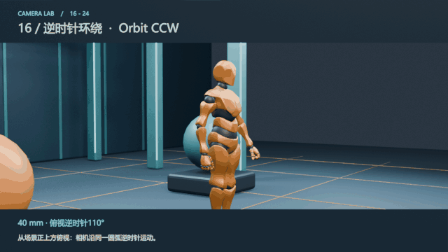

Blender第1801至1920帧，每段5秒。参数：40 mm · 俯视逆时针110°。

**特点**：相机沿同一110度圆弧反向环绕，持续看向主体；从正上方俯视，方向为逆时针。

**用途**：选择另一侧的背景揭示顺序、展示主体另一面、与前一个环绕构成方向对照。顺逆方向本身不固定代表善恶或情绪。

**观察**：与顺时针对照：机位路径反向，背景展开顺序和人物侧面变化也反向。

**景别搭配**：中景和全身景都可使用；可维持基本相同的景别。

**提示词要点**：从相机画面看背景向哪边动，不能直接当成俯视顺逆时针的定义。

**中文通用运镜模板**

从场景正上方俯视判定方向，相机沿逆时针圆弧平稳环绕主体[环绕角度]。持续对准主体，保持环绕半径、拍摄高度和焦距，以[景别]取景。主体基本居中，主体的可见侧面与背景关系随实际机位变化而连续改变。

**English camera-motion template**

Using a view from directly above as the direction reference, orbit the camera counterclockwise around the subject through [orbit angle]. Aim continuously at the subject, maintaining radius, camera height and focal length in a [shot size]. Keep the subject approximately centered while its visible sides and background relationships change continuously with the moving viewpoint.

关键词：counterclockwise orbit / top-down reference / fixed radius

## 17 变焦推近 Zoom In

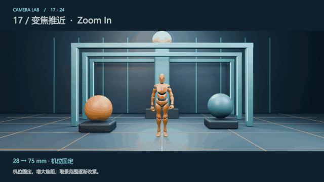

Blender第1921至2040帧，每段5秒。参数：28 → 75 mm · 机位固定。

**特点**：相机位置和朝向固定，镜头焦距增加，视角变窄、人物变大。相同机位下的透视关系保持不变；本例没有模拟镜头畸变或呼吸效应。

**用途**：收紧取景以强调线索、对远处人物快速集中注意力、营造有意的光学观察感。

**观察**：人物与背景一起按比例放大，不出现由相机前进造成的新视点。

**景别搭配**：可从远景收紧到中景、近景；终点景别取决于焦距与距离。

**提示词要点**：把“zoom in”当作推进使用，会混淆机位移动和焦距变化。

**中文通用运镜模板**

相机位置和朝向固定，镜头焦距平稳增大，视角逐渐收窄，取景由[起始景别]收紧到[结束景别]。主体与背景一起放大，透视与遮挡关系保持同一机位下的关系，运动表现为连续的光学变焦。

**English camera-motion template**

Lock the camera position and orientation while smoothly increasing the lens focal length. Narrow the field of view and tighten framing from [starting shot size] to [ending shot size]. Subject and background enlarge together, preserving perspective and occlusion relationships from the same viewpoint. Show a continuous optical zoom.

关键词：zoom in / locked camera position / increase focal length

## 18 变焦拉远 Zoom Out

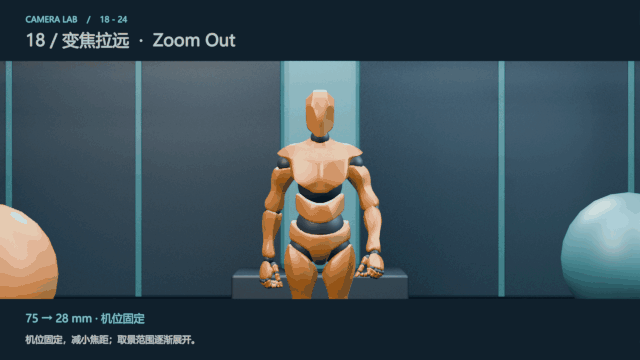

Blender第2041至2160帧，每段5秒。参数：75 → 28 mm · 机位固定。

**特点**：相机位置和朝向固定，镜头焦距减小、视角展开。画面内容增加，但不会因机位后退产生新的透视关系。

**用途**：逐步交代画面外的环境、从细节返回整体、表现观察范围被扩大。

**观察**：人与背景一起缩小，新增环境从画面边缘进入。

**景别搭配**：可从中景或近景展开到全身景、远景。

**提示词要点**：“拉远”需进一步明确：这是焦距变化的变焦拉远，还是摄影机后退的拉镜头。

**中文通用运镜模板**

相机位置和朝向固定，镜头焦距平稳减小，视角逐渐展开，取景由[起始景别]扩大到[结束景别]。主体与背景一起缩小，更多周围空间从画面边缘进入，透视关系保持同一机位下的关系。

**English camera-motion template**

Lock the camera position and orientation while smoothly decreasing the lens focal length. Widen the field of view and expand framing from [starting shot size] to [ending shot size]. Subject and background shrink together as more surrounding space enters at the edges. Preserve perspective relationships from the same viewpoint.

关键词：zoom out / locked position / decrease focal length

## 19 推近滑动变焦 Dolly Zoom In

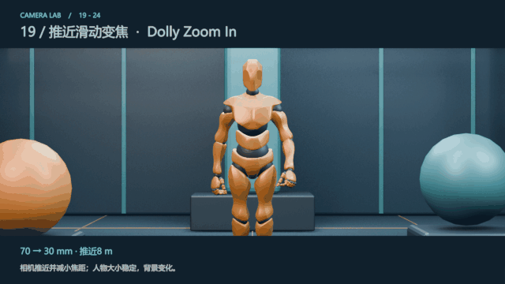

Blender第2161至2280帧，每段5秒。参数：70 → 30 mm · 推近8 m。

**特点**：希区柯克变焦的一种：相机前进，同时减小焦距。两者配合使主体在画面中的大小近似不变，主体与背景的相对比例明显改变。

**用途**：突然意识到危险、惊讶、眩晕或心理变化；也可用于有意的空间变形。选择有纵深的背景更容易看出效果。

**观察**：重点看人物大小基本稳定，而远处立柱相对人物变小、纵深感展开。前景会有自己的变化，不必与远景同向缩放。

**景别搭配**：常用中景、中近景便于读表情；主体景别可以基本不变，背景关系仍明显改变。

**提示词要点**：只同时写推进和变焦还不够，要明确两者反向配合并维持主体尺寸。

**中文通用运镜模板**

执行向前推进的希区柯克变焦：相机缓慢向主体实际推进，同时平稳减小焦距、扩大视角。精确配合两种变化，使主体在画面中的位置和大小基本不变，维持[景别]；远处背景相对主体缩小，空间纵深感逐步展开。

**English camera-motion template**

Perform a forward dolly zoom: physically move the camera slowly toward the subject while smoothly decreasing focal length and widening the field of view. Coordinate both changes to keep the subject’s screen position and size nearly constant in a [shot size]. Distant background elements become smaller relative to the subject, opening up the sense of spatial depth.

关键词：dolly zoom in / Vertigo effect / move forward and zoom out / constant subject size

## 20 后退滑动变焦 Dolly Zoom Out

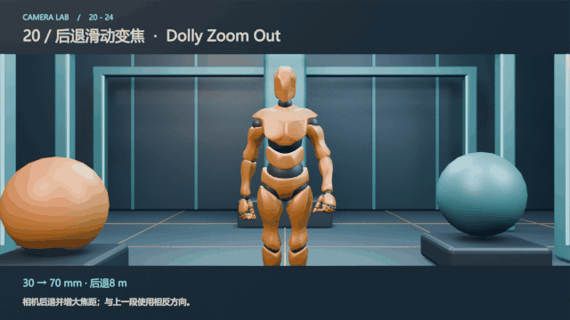

Blender第2281至2400帧，每段5秒。参数：30 → 70 mm · 后退8 m。

**特点**：希区柯克变焦的反向版本：相机后退，同时增大焦距，以保持主体画面大小近似不变。远景相对主体变大，空间关系产生压缩感。

**用途**：震惊、压迫、心理疏离或周围空间突然逼近的感觉；具体叙事含义取决于表演与场景。

**观察**：与上一段对照，人物大小保持稳定，但远处立柱相对人物变大、背景显得靠拢。

**景别搭配**：中景、中近景便于同时看主体表情和背景变化；景别并不一定由近变远。

**提示词要点**：不要写成“相机后退且人物越来越小”，这会破坏滑动变焦的补偿关系。

**中文通用运镜模板**

执行向后退的希区柯克变焦：相机缓慢远离主体，同时平稳增大焦距、缩窄视角。精确配合两种变化，使主体在画面中的位置和大小基本不变，维持[景别]；远处背景相对主体增大，空间呈现逐步压缩靠拢的感觉。

**English camera-motion template**

Perform a backward dolly zoom: physically move the camera slowly away from the subject while smoothly increasing focal length and narrowing the field of view. Coordinate both changes to keep the subject’s screen position and size nearly constant in a [shot size]. Distant background elements grow relative to the subject, producing a gradually compressed, approaching sense of space.

关键词：dolly zoom out / move backward and zoom in / constant subject size

## 21 向左甩镜头 Whip Pan Left

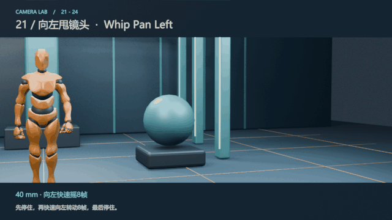

Blender第2401至2520帧，每段5秒。参数：40 mm · 向左快速摇8帧。

**特点**：机位固定，镜头快速向左甩动，再停住。它是快速水平摇镜头，区别主要在速度及伴随的运动模糊。

**用途**：快速转移注意力、跟随突然行动、连接两个空间或为剪辑转场提供动势。

**观察**：本段先停，再用8个源帧约0.33秒左甩，随后停住；GIF保留24fps采样以显示这一短动作。

**景别搭配**：可连接两个相近景别或从人物摇到环境；起点与落点对象都应明确。

**提示词要点**：甩镜不是快速横向平移，也不是画面剪切。应描述转动、短暂模糊及最终落点。

**中文通用运镜模板**

相机中心位置固定，先在[起始取景对象]上短暂停留，随后迅速水平向左甩动，带短暂横向运动模糊，最后停稳在左侧的[落点对象]上。焦距与拍摄高度恒定，停留、快速转动和停稳构成一个连续镜头。

**English camera-motion template**

Keep the camera center fixed. Briefly hold on [starting visual target], then whip pan rapidly to the camera’s left with brief horizontal motion blur. Settle on [landing visual target] to the left. Maintain focal length and camera height through the hold, rapid rotation and settled ending within one continuous shot.

关键词：whip pan left / fast horizontal rotation / settle on target

## 22 向右甩镜头 Whip Pan Right

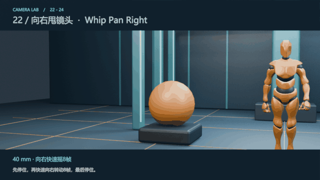

Blender第2521至2640帧，每段5秒。参数：40 mm · 向右快速摇8帧。

**特点**：机位固定，镜头快速向右转动并停稳；是左甩的方向对照。

**用途**：向右追随突发动作、将关注点快速交给另一对象、衔接有右向动势的转场。

**观察**：短时间内背景快速向左滑过，落点重新稳定。

**景别搭配**：可在同一景别切换关注点，也可用宽一些的取景保留落点环境。

**提示词要点**：需要写停留、甩动和停稳三个阶段，否则可能得到整段持续快速旋转。

**中文通用运镜模板**

相机中心位置固定，先在[起始取景对象]上短暂停留，随后迅速水平向右甩动，带短暂横向运动模糊，最后停稳在右侧的[落点对象]上。焦距与拍摄高度恒定，停留、快速转动和停稳构成一个连续镜头。

**English camera-motion template**

Keep the camera center fixed. Briefly hold on [starting visual target], then whip pan rapidly to the camera’s right with brief horizontal motion blur. Settle on [landing visual target] to the right. Maintain focal length and camera height through the hold, rapid rotation and settled ending within one continuous shot.

关键词：whip pan right / hold then rotate quickly then settle

## 23 手持后方跟拍 Handheld Rear

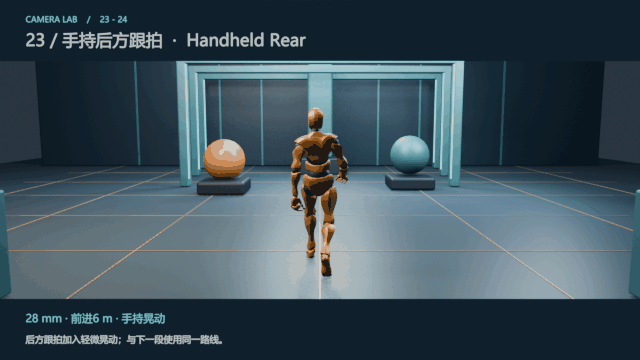

Blender第2641至2760帧，每段5秒。参数：28 mm · 前进6 m · 手持晃动。

**特点**：本例在后方跟拍路径上加入小幅位置和角度晃动，模拟手持感。手持属于拍摄稳定方式，可以叠加在跟拍、推拉等路径上。

**用途**：纪录感、贴近人物的临场感、紧张或不确定的体验。小幅晃动与剧烈晃动会产生不同的观看体验。

**观察**：与稳定后方跟拍对照，相同路线上的边缘、地平线和人物构图存在轻微波动。

**景别搭配**：全身景或中景均可；近景更容易让同样的晃动显得剧烈。

**提示词要点**：只写“手持”容易产生过强抖动；这里要写小幅、受控、人物持续可读。

**中文通用运镜模板**

相机从移动主体正后方同步跟随，以[景别]取景，保持近似相同的距离与焦距。运动中叠加轻微、受控的位置晃动和角度波动，主体持续清晰可读、基本居中，周围环境连续流动，形成自然的手持跟拍感。

**English camera-motion template**

Track from directly behind the moving subject at matching speed in a [shot size], maintaining approximately constant distance and focal length. Add subtle, controlled positional shake and small angular fluctuations. Keep the subject readable and approximately centered while the surroundings flow continuously, creating a natural handheld tracking feel.

关键词：subtle handheld rear tracking / controlled micro-shake

## 24 稳定后方跟拍 Stabilized Rear

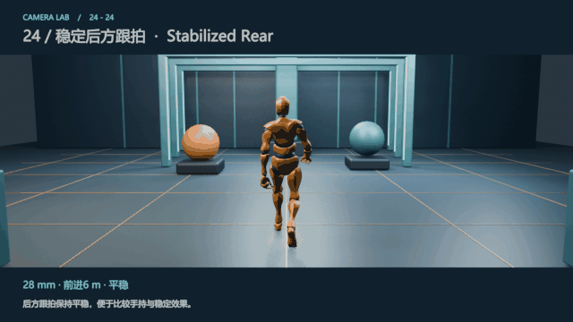

Blender第2761至2880帧，每段5秒。参数：28 mm · 前进6 m · 平稳。

**特点**：本例采用与后方跟拍相同的路线，去除手持晃动。稳定器、斯坦尼康或轨道均可形成平稳运动，设备名称不等于某一种路径。

**用途**：空间导览、产品展示、流畅的长镜头、希望观众集中在人物行动和场景细节时。

**观察**：与手持段相比，人物与地平线更稳定；与第09段路线相同，是用于对照的示例。

**景别搭配**：全身景看路线，中景看动作；稳定方式本身不决定景别。

**提示词要点**：“稳定”仍可以移动；固定镜头则是相机中心和朝向都保持不变。

**中文通用运镜模板**

相机从移动主体正后方平稳同步跟随，以[景别]取景，保持相同距离、高度与焦距，水平线稳定。主体在画面中的位置和大小基本恒定，周围环境连续流动，形成流畅的稳定跟拍效果。

**English camera-motion template**

Track smoothly from directly behind the moving subject at matching speed in a [shot size]. Maintain distance, height and focal length with a stable horizon. Keep the subject’s screen position and size nearly constant while the surroundings flow continuously, producing fluid stabilized tracking.

关键词：smooth stabilized tracking / level horizon / matching speed

## 文生视频提示词使用方法

使用“你的主体、动作与场景描述＋通用运镜模块”。方括号是可替换参数，按需求填写。速度、时长和画幅可另行设定。

1. **组合方式**：使用“你的主体、动作与场景描述＋本手册的通用运镜模块”。场景、服装、灯光和风格由你自己的创作提示词决定。
2. **填写可变参数**：将[景别]、[起始景别]、[结束景别]、[取景对象]、[高度]或[环绕角度]填成所需内容，例如中景、腰部以上或90度。起点和终点应符合所选运动。
3. **保留运动参照**：左右按摄影机朝向判断；环绕顺逆按正上方俯视判断；侧面跟拍的左右按主体行进方向判断。需要时直接加入模板里的参照句。
4. **协调主体动作**：跟拍模板适用于移动主体，应在自己的主体描述中交代行进路线或动作。其他运镜模板可按需要搭配站立、行走、车辆、物件或其他主体。
5. **设置与迭代**：时长和画幅在平台生成设置中选择；速度、景别与环绕角度可按创作需求调整。模板中的几何描述表达目标画面，生成后应检查方向、主体大小、视差与终点是否符合要求。

## 参考来源

用途为本项目教学说明，提示词为原创通用运镜模板；GIF来自Blender实际渲染，提示词尚未运行生成。官方来源核对日期：2026年10月13日。

- [Runway 文生视频提示词指南](https://help.runwayml.com/hc/en-us/articles/42460036199443-Text-to-Video-Prompting-Guide)。用于参考场景、主体动作与摄影机运动的表述方式。
- [Runway 相机术语与示例](https://help.runwayml.com/hc/en-us/articles/47313504791059-Camera-Terms-Prompts-Examples)。用于核对摄影机术语；本文示例和提示词均为本项目编写。
- [Google 视频生成提示词指南](https://docs.cloud.google.com/vertex-ai/generative-ai/docs/video/video-gen-prompt-guide)。用于参考机位、朝向、路径和速度的分开描述。
- [Seedance 2.5 官方提示词指南 火山引擎](https://docs.volcengine.com/docs/ark/seedance-2-5-prompt-guide?lang=zh)。包含景别、推拉摇移、环绕、希区柯克变焦、时间轴以及运镜参考的写作建议。
- [Seedance 2.5 官方介绍 字节跳动 Seed](https://seed.bytedance.com/en/blog/one-take-creation-flexible-referencing-introducing-seedance-2-5)。用于查阅模型能力、运镜参考与白模参考示例。
- [Adobe 希区柯克变焦说明](https://www.adobe.com/creativecloud/video/production/cinematography/camera-shots-and-angles/dolly-zoom-shot.html)。用于核对滑动变焦的相机移动与反向变焦关系。
